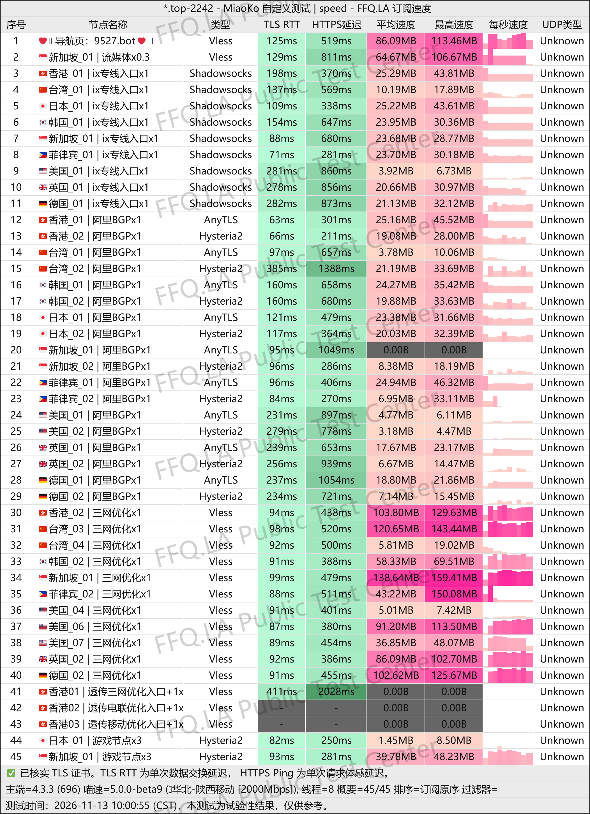
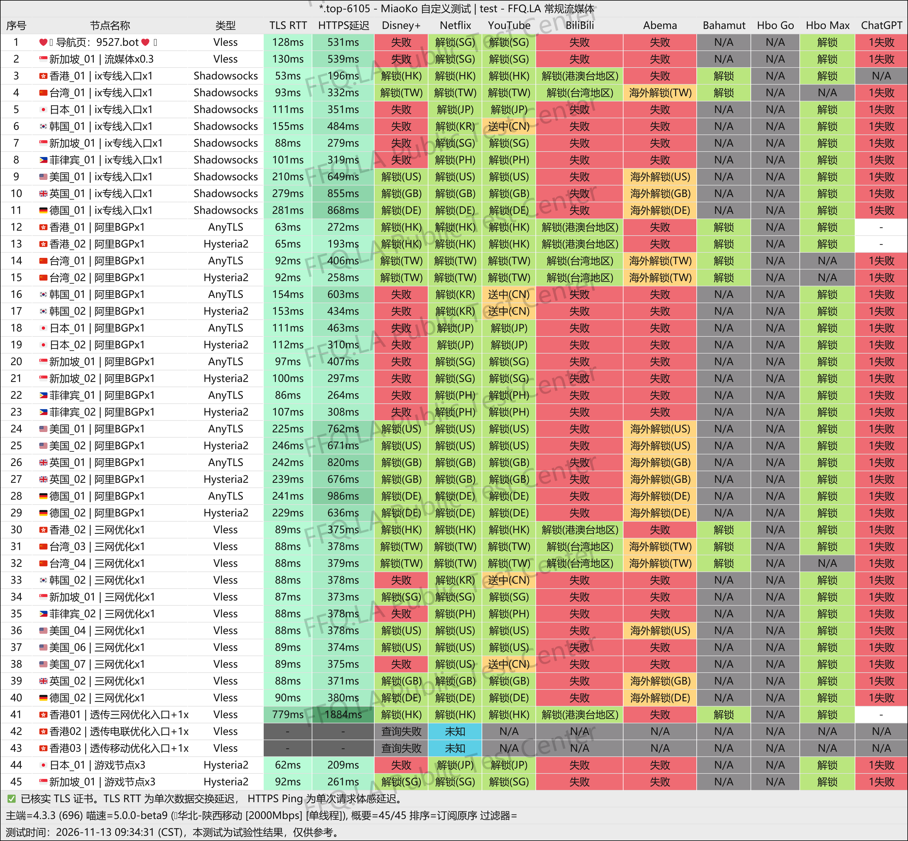
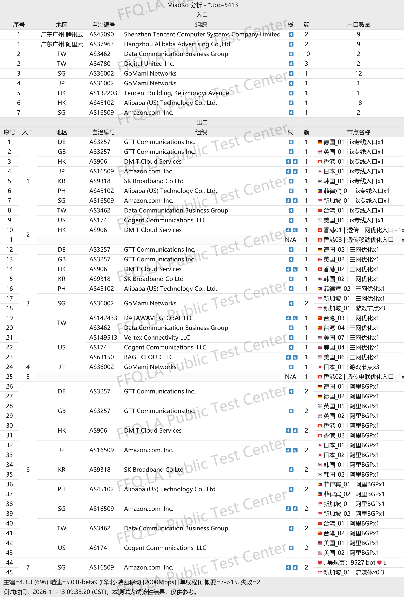

🇨🇳 中文 | 🇺🇸 [English](README_EN.md) | 🇷🇺 
[Русский](README_RU.md) | 🇮🇷 [فارسی](README_FA.md)

# 9527机场官方地址(2026年11月13日更新)
9527机场官网地址</br>
最新地址01：[9omvqop5.9527.now](https://to.iix.im/952701)</br>
最新地址02：[xpp7iakl.9527.now](https://to.iix.im/952702)</br>
官方地址：[9527.bot](https://to.iix.im/952703)</br>

2026最新好用的机场推荐与节点分享：[https://github.com/jdnei/JiChangTuiJian](https://github.com/jdnei/JiChangTuiJian)</br>
## Telegram VPN 机场福利社 #AD
[机场抽奖群](https://331024.de/archives/choujiang)｜[机场聊天群](https://331024.de/archives/choujiang)｜[机场体验群](https://331024.de/archives/choujiang)</br>

[https://331024.de/archives/choujiang](https://331024.de/archives/choujiang)
## 邀请码
`此邀请码注册，可得50g试用套餐(此活动官方随时取消)`
```bash
pRRT1AZw
```

## 优惠码/折扣码
```bash

```
## 简介
9527机场（9527VPN）是一家于2026年10月上线的网络加速服务商，采用VLESS协议，主打国内多运营商优化入口与海外中转线路。节点覆盖日本、美国、新加坡等地区，提供免费试用及不同流量套餐，适合日常上网、影音娱乐、跨境办公及多设备用户使用。
## 优势
9527机场（9527VPN）主打三网优化与海外中转线路，采用国内入口结合Goma中转的网络架构，兼顾速度与连接体验。日本、美国、新加坡等部分节点采用0.5倍流量倍率，降低套餐流量消耗。提供新人9.9元优惠套餐及免费试用，支持先体验后购买，适合日常使用和备用网络需求。
## 套餐

| 套餐               | 流量         | 价格        | 付款周期                           | 同时在线设备 | 线路类型                              | 节点倍率           | 流媒体 / AI 解锁                                                                   | 特色 / 备注                  |
| ---------------- | ---------- | --------- | ------------------------------ | ------ | --------------------------------- | -------------- | ----------------------------------------------------------------------------- | ------------------------ |
| 臻选三网新人体验套餐       | 50GB / 月   | ¥9.90 / 月 | 月付                             | 1 台    | 电信 CN2 GIA / 联通 AS9929 / 移动 CMIN2 | 部分节点 0.3–0.5 倍 | Netflix、Disney+、HBO Max、Prime Video、YouTube；ChatGPT、Gemini、Copilot、Midjourney | 新用户限购一次，不可续费、不享折扣；适合外服游戏 |
| 臻选三网专线 · 50GB版   | 50GB / 月   | ¥14 / 月   | 月付 / 季付 / 半年付 / 年付 / 两年付 / 三年付 | 不限     | 电信 CN2 GIA / 联通 AS9929 / 移动 CMIN2 | 部分节点 0.3–0.5 倍 | Netflix、Disney+、HBO Max、Prime Video、YouTube；ChatGPT、Gemini、Copilot、Midjourney | 年付约85折；适合多设备使用           |
| 臻选三网专线 · 100GB版  | 100GB / 月  | ¥25 / 月   | 月付 / 季付 / 半年付 / 年付 / 两年付 / 三年付 | 不限     | 电信 CN2 GIA / 联通 AS9929 / 移动 CMIN2 | 部分节点 0.3–0.5 倍 | Netflix、Disney+、HBO Max、Prime Video、YouTube；ChatGPT、Gemini、Copilot、Midjourney | 年付约85折；适合多设备使用           |
| 臻选三网专线 · 200GB版  | 200GB / 月  | ¥49 / 月   | 月付 / 季付 / 半年付 / 年付 / 两年付 / 三年付 | 不限     | 电信 CN2 GIA / 联通 AS9929 / 移动 CMIN2 | 部分节点 0.3–0.5 倍 | Netflix、Disney+、HBO Max、Prime Video、YouTube；ChatGPT、Gemini、Copilot、Midjourney | 年付约85折；适合多设备使用           |
| 臻选三网专线 · 350GB版  | 350GB / 月  | ¥85 / 月   | 月付 / 季付 / 半年付 / 年付 / 两年付 / 三年付 | 不限     | 电信 CN2 GIA / 联通 AS9929 / 移动 CMIN2 | 部分节点 0.3–0.5 倍 | Netflix、Disney+、HBO Max、Prime Video、YouTube；ChatGPT、Gemini、Copilot、Midjourney | 年付约85折；适合多设备使用           |
| 臻选三网专线 · 700GB版  | 700GB / 月  | ¥165 / 月  | 月付 / 季付 / 半年付 / 年付 / 两年付 / 三年付 | 不限     | 电信 CN2 GIA / 联通 AS9929 / 移动 CMIN2 | 部分节点 0.3–0.5 倍 | Netflix、Disney+、HBO Max、Prime Video、YouTube；ChatGPT、Gemini、Copilot、Midjourney | 年付约85折；适合多设备使用           |
| 臻选三网专线 · 1000GB版 | 1000GB / 月 | ¥230 / 月  | 月付 / 季付 / 半年付 / 年付 / 两年付 / 三年付 | 不限     | 电信 CN2 GIA / 联通 AS9929 / 移动 CMIN2 | 部分节点 0.3–0.5 倍 | Netflix、Disney+、HBO Max、Prime Video、YouTube；ChatGPT、Gemini、Copilot、Midjourney | 年付约85折；适合多设备使用           |
| 不限时100GB套餐       | 100GB（总量）  | ¥55       | 一次性 / 不限时                      | 不限     | 电信 CN2 GIA / 联通 AS9929 / 移动 CMIN2 | 部分节点 0.3–0.5 倍 | 未明确注明                                                                         | 不限使用期限，不按月重置，流量用完即止      |
| 不限时200GB套餐       | 200GB（总量）  | ¥105      | 一次性 / 不限时                      | 不限     | 电信 CN2 GIA / 联通 AS9929 / 移动 CMIN2 | 部分节点 0.3–0.5 倍 | 未明确注明                                                                         | 不限使用期限，不按月重置，流量用完即止      |

### 套餐说明

- **三网优化：** 商家标称针对电信 CN2 GIA、联通 AS9929、移动 CMIN2 线路优化。
- **流量倍率：** 部分流媒体节点提供 0.3 倍、0.5 倍计费倍率，并非全部节点均为低倍率。
- **流量刷新：** 常规套餐按月提供流量额度；不限时套餐不重置，流量用完为止。
- **设备限制：** 新人体验套餐仅限1台设备，其他套餐不限设备连接数量。
- **年付优惠：** 常规套餐页面标注年付约85折，实际价格以下单页面为准。
- **使用场景：** 支持 Windows、macOS、iOS、Android、Linux 等平台，适用于流媒体、AI工具及海外游戏。
- **注意事项：** 实际速度、线路表现和解锁能力受所在地区、运营商及本地网络环境影响。

## 📊 性能实测与分析
#### 1.晚高峰测速表现
</br>
#### 2.流媒体解锁报告
</br>
#### 3.落地入口分析
</br>
